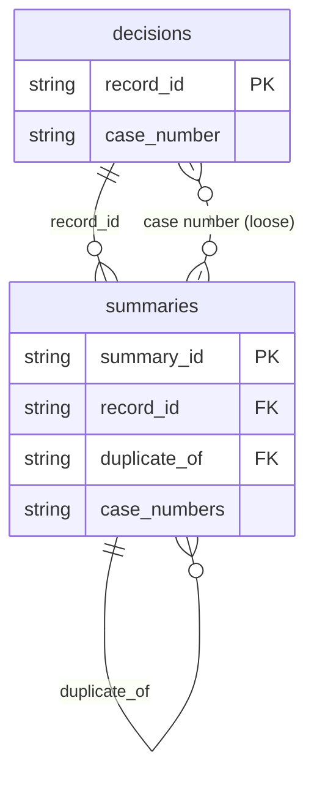

<!-- Generated by src/data_docs.py; edit docs/tables.toml instead. -->
# Data dictionary

Generated by `src/data_docs.py` on 2026-11-16 from Hugging Face `abigailhaddad/nlrb-decisions` at commit `d73ecae4`. Types, row counts, non-null shares and examples are read from the parquet files; descriptions are in `docs/tables.toml` in the GitHub repo. Columns marked **(meaning not confirmed)** are ones whose meaning the source does not define.

| table | file | Hugging Face config | rows | one row is |
|---|---|---|---|---|
| `decisions` | `decisions.parquet` | `default` | 77,709 | One row per entry on one of NLRB's three decision listings (Board, unpublished Board, administrative law judge). |
| `summaries` | `summaries.parquet` | `summaries` | 11,696 | One row per decision summarized on one of NLRB's weekly Summary of NLRB Decisions pages. NLRB's summary, not the decision text. |

## How the tables join

- `decisions.record_id` to `summaries.record_id`: Exact join. Each summary matches at most one decision; a decision can have zero, one or several summaries.
- `summaries.summary_id` to `summaries.duplicate_of`: A summary that repeats an earlier one word for word points to it.
- `decisions.case_number` to `summaries.case_numbers`: Not an exact join: `case_numbers` holds several numbers and drops leading zeros. Normalize both sides before comparing. Use `record_id` where it is filled.

## `decisions` (`decisions.parquet`, config `default`)

One row per entry on one of NLRB's three decision listings (Board, unpublished Board, administrative law judge).

Non-null and non-blank are shares of the table's rows; non-blank also leaves out empty strings.

| column | type | description | non-null | non-blank | example |
|---|---|---|---|---|---|
| `record_id` | string | Unique row id: `listing\|document_id`, e.g. `board\|09031d45843ede05`. Primary key. | 100.0% | 100.0% | `board\|09031d45843ede05` |
| `listing` | string | Which listing the entry is on: `board`, `unpublished` or `alj`. | 100.0% | 100.0% | `board` |
| `listing_title` | string | The listing's title on nlrb.gov: Board Decisions, Unpublished Board Decisions, Administrative Law Judge Decisions. | 100.0% | 100.0% | `Board Decisions` |
| `citation` | string | Board listing only. The citation as listed, e.g. `375 NLRB No. 68` (slip opinion) or `300 NLRB 1065` (bound volume page). A few Board rows are blank or show `00 NLRB No. 00`. | 85.8% | 85.8% | `375 NLRB No. 68` |
| `volume` | int64 | NLRB volume number read from `citation`. Blank when the citation is missing, unreadable or `00 NLRB No. 00`. | 85.7% | 85.7% | `375` |
| `citation_form` | string | How `citation` is written: `slip opinion number` (`375 NLRB No. 68`), `bound volume page` (`300 NLRB 1065`) or `placeholder` (`00 NLRB No. 00`). | 85.8% | 85.8% | `slip opinion number` |
| `citation_number` | int64 | The slip opinion number or bound volume page read from `citation`. | 85.7% | 85.7% | `68` |
| `case_name` | string | Case name as listed. A name exactly 100 characters long is usually cut off mid-word on NLRB's listing; some names are longer than 100. | 100.0% | 99.9% | `Blick Art Materials, LLC` |
| `case_number` | string | Case number as listed, e.g. `13-CA-393585`. Some old or mistyped numbers have other forms. | 100.0% | 100.0% | `13-CA-393585` |
| `case_number_usual_form` | bool | True if `case_number` matches the usual form: two digits, one or two capital letters, three to six digits (`^\d{2}-[A-Z]{1,2}-\d{3,6}$`). | 100.0% | 100.0% | `True` |
| `issuance_date` | string | Issuance date, YYYY-MM-DD, from the listing. Blank when the listing shows no date, an unreadable one, or `01/01/0001`. | 99.8% | 99.8% | `2026-11-12` |
| `issuance_date_raw` | string | Issuance date exactly as listed (MM/DD/YYYY), including `01/01/0001`. | 100.0% | 100.0% | `11/12/2026` |
| `year` | string | First four characters of `issuance_date` (text). | 99.8% | 99.8% | `2026` |
| `jd_number` | string | ALJ listing only. The listing's JD Number column, as listed. | 7.0% | 7.0% | `JD-75-26` |
| `judge` | string | ALJ listing only. The listing's Judge column (the administrative law judge), as listed. | 7.0% | 6.3% | `GEOFFREY CARTER` |
| `board_outcome` | string | ALJ listing only. The listing's Board Outcome column, as listed (e.g. `Pending Board Decision`, `Affirm`, `Adopted/No Exceptions Filed`); often an empty string. NLRB does not define the values. **(meaning not confirmed)** | 7.0% | 3.4% | `Pending Board Decision` |
| `document_url` | string | Link to the decision document on apps.nlrb.gov, from the case name cell of the listing. | 100.0% | 100.0% | `https://apps.nlrb.gov/link/document.aspx/09031d45843ede05` |
| `document_id` | string | NLRB's document id: the hex string after `document.aspx/` in `document_url`. | 100.0% | 100.0% | `09031d45843ede05` |
| `case_url` | string | Link to the case page on nlrb.gov, from the case number cell of the listing. | 100.0% | 100.0% | `https://www.nlrb.gov/case/13-CA-393585` |

## `summaries` (`summaries.parquet`, config `summaries`)

One row per decision summarized on one of NLRB's weekly Summary of NLRB Decisions pages. NLRB's summary, not the decision text.

Non-null and non-blank are shares of the table's rows; non-blank also leaves out empty strings.

| column | type | description | non-null | non-blank | example |
|---|---|---|---|---|---|
| `summary_id` | string | Unique row id: the week page's URL slug, `#`, and `entry_index`. Primary key. | 100.0% | 100.0% | `summary-of-nlrb-decisions-for-week-of-november-2-6-2026#0` |
| `record_id` | string | The matched row in `decisions` (its `record_id`), or blank. A match is made only when exactly one decisions row qualifies; appellate entries are never matched. | 84.7% | 84.7% | `unpublished\|09031d45843dec5d` |
| `match_method` | string | How `record_id` was matched: `citation` or `case number + date`. Blank when unmatched. | 84.7% | 84.7% | `case number + date` |
| `match_note` | string | Why the entry is unmatched, or a note on a match (e.g. `citation not in table`). | 26.7% | 26.7% | `court decision; not in decisions.parquet` |
| `duplicate_of` | string | `summary_id` of an earlier entry with the same header (ignoring spacing) and the same summary text. NLRB posts some weeks twice under different addresses; both copies are kept. | 0.3% | 0.3% | `summary-of-nlrb-decisions-for-week-of-september-26-30#3` |
| `week_url` | string | URL of the weekly summary page. | 100.0% | 100.0% | `https://www.nlrb.gov/cases-decisions/weekly-summaries-decisi...` |
| `week_title` | string | Title of the week as shown on NLRB's weekly-summaries index. | 100.0% | 100.0% | `Summary of NLRB Decisions for Week of November 2 -6, 2026` |
| `week_posted` | string | Date shown next to the week on the weekly-summaries index (its `<time datetime>`), YYYY-MM-DD. | 100.0% | 100.0% | `2026-11-12` |
| `section` | string | Section of the week page the entry is under: `board` (summarized/published Board decisions), `unpublished`, `alj` or `appellate` (court decisions). | 100.0% | 100.0% | `unpublished` |
| `subsection` | string | Sub-heading within the section as written on the page, e.g. `C Cases`, `R Cases` (almost all on unpublished entries). Blank when there is none; a few odd values (e.g. `* **`) are as found. | 42.5% | 42.5% | `R Cases` |
| `entry_index` | int64 | Position of the entry on its week page, counting from 0. | 100.0% | 100.0% | `0` |
| `case_name` | string | Case name from the entry's header, as written. | 100.0% | 100.0% | `OQ Chemicals Corporation` |
| `case_numbers` | string | Case numbers from the header, `; `-separated, normalized to `NN-XX-N` with no leading zeros in the last part (so `21-CA-073942` becomes `21-CA-73942`). | 100.0% | 100.0% | `16-RC-354943` |
| `header_parenthetical` | string | Board, unpublished and ALJ entries: the text inside the header's parentheses (case numbers, citation, JD number). Appellate entries: the header from the first case number on. | 100.0% | 100.0% | `16-RC-354943` |
| `citation` | string | Board entries only: the NLRB citation from the header, e.g. `375 NLRB No. 25`. | 27.2% | 27.2% | `375 NLRB No. 64` |
| `jd_number` | string | ALJ entries (and one unpublished entry): the JD number from the header, as written, e.g. `JD-05-21` or `JD(SF)-37-24`. | 23.0% | 23.0% | `JD-70-26` |
| `reported_at` | string | Appellate entries only: the NLRB citation(s) of the Board decision the court reviewed, from the header (`reported at 374 NLRB No. 36`), `; `-separated. | 6.5% | 6.5% | `374 NLRB No. 36` |
| `court` | string | Appellate entries only: the court, as written in the header (e.g. `5th Cir.`, `D.C. Cir.`). | 5.6% | 5.6% | `5th Cir.` |
| `place` | string | Board, unpublished and ALJ entries: text between the header's closing parenthesis and the date (or the first sentence end), usually a city and state (e.g. `Compton, CA`). NLRB does not say whose location it is. **(meaning not confirmed)** | 90.5% | 90.5% | `Bay City, TX` |
| `date` | string | YYYY-MM-DD. Board, unpublished and ALJ entries: the date in the header, or for ALJ entries the date in `issued ... decision on <date>` in the summary text. Appellate entries: the last date in the header (the court's decision date). Kept as written even when NLRB mistyped the year. | 99.1% | 99.1% | `2026-11-02` |
| `date_source` | string | Where `date` came from: `header` or `summary text`. Blank when there is no date. | 99.1% | 99.1% | `header` |
| `header_date_text` | string | The date as written on the page, before conversion. | 99.1% | 99.1% | `November 2, 2026` |
| `header` | string | The entry's header as written: the case name, the parenthetical, and place and date. | 100.0% | 100.0% | `OQ Chemicals Corporation (16-RC-354943) Bay City, TX, Novemb...` |
| `summary_text` | string | NLRB's summary as written, apart from whitespace (tags removed, entities decoded, runs of spaces made one); paragraphs separated by a blank line. | 100.0% | 100.0% | `A Board majority (Chairman Murphy and Member Prouty; Member ...` |
